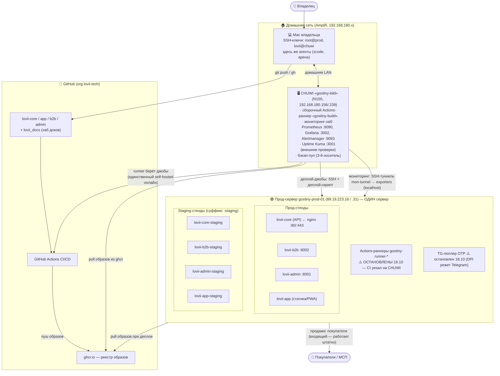
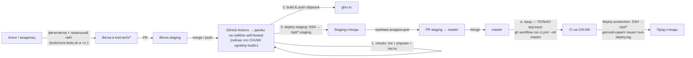
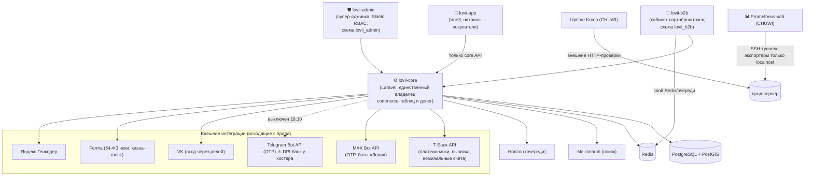
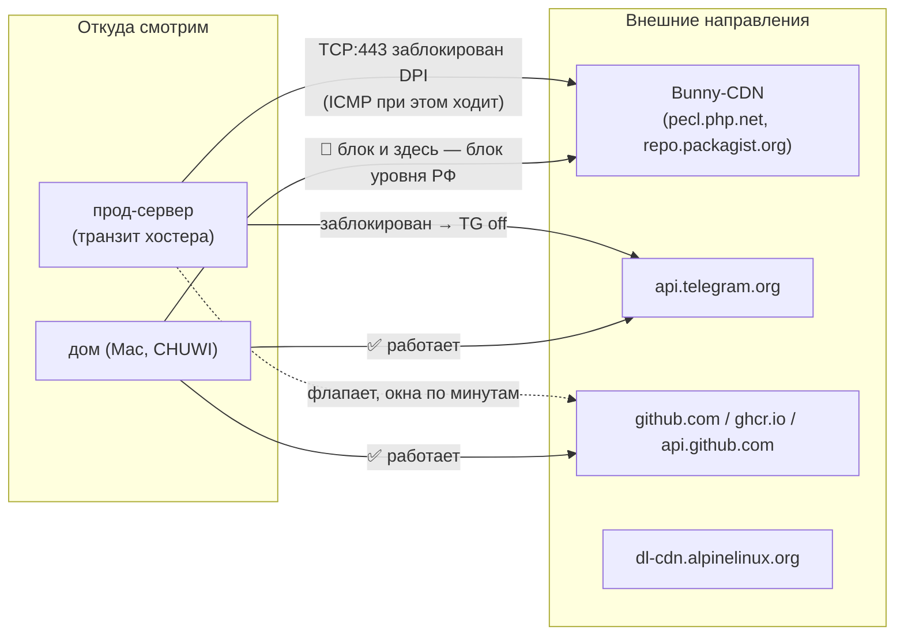
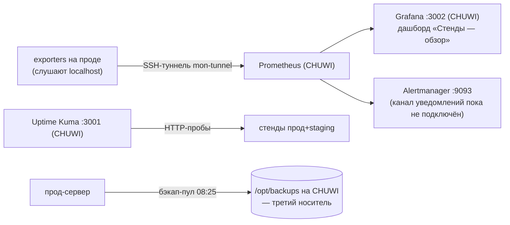

# Топология платформы «Лови» — как всё связано

> Живая схема текущего состояния (актуализирована ночью 18.10.2026 после сетевого
> инцидента). Рисована в Mermaid — GitHub рендерит прямо здесь. Служит входной
> точкой для вопросов «а что откуда зависит»; детальные каноны — по ссылкам.

## 1. Общая инфраструктура: три машины + GitHub

**Ключевой факт сети:** прод и staging — один физический сервер; различие только в
суффиксах контейнеров и портах. CHUWI — единственный активный CI-раннер с ночи
18.10 (после DPI-инцидента на транзите хостера).

## 2. Путь релиза (CI/CD) — как код доезжает до прода

Замечания к текущему состоянию:
- джобы «Build & push» и «deploy» физически исполняет CHUWI (прод-раннеры остановлены);
  деплой-скрипт на сервере валидирует SHA и пишет в `/home/deploy/lovii-deploy.log`;
- локальный гейт перед пушем обязателен (канон `ПРОТОКОЛ-ЛОКАЛЬНОГО-СТЕНДА.md`);
- сборка образов **не зависит от pecl.php.net** с 18.10 (PR #27: phpredis/xdebug
  собираются с GitHub, opcache уже вкомпилен в PHP 8.5).

## 3. Компоненты и кто с кем говорит

Правило архитектуры: app/b2b/admin **никогда не ходят в БД напрямую мимо core** —
все commerce-данные и деньги принадлежат core.

## 4. Сеть: что где работает после DPI-инцидента 17.10

Следствия (уже сделано):
- сборка отвязана от pecl — блок Bunny больше не роняет релизы;
- CI исполняется на CHUWI (дом), у которого ghcr и GitHub стабильны;
- Telegram на проде выключен владельцем (не обязателен; MAX/VK живы).

## 5. Мониторинг и бэкапы

- Grafana: `grafana.lan:3002` (учётка lovii), Prometheus: `prom.lan:9090`;
- алерты описаны, канал доставки не подключён — Kuma пока сторож;
- чистка диска прода — при заполнении >75% (сейчас ~55%).

## 6. Открытые развилки / хвосты (на момент 18.10)

| # | Вопрос | Кто решает |
|---|---|---|
| 1 | CI остаётся на CHUWI постоянно или вернуть прод-раннеры после починки транзита? | владелец |
| 2 | Тикет хостеру про DPI (Telegram + ghcr) — пруфы собраны | владелец («го») |
| 3 | TG-поллер прода вернётся при следующем деплое — выключить флагом env? | владелец («го») |
| 4 | Обновить канон CI_RUNNERS_SELFHOSTED.md (деплой теперь не на прод-раннерах) | куратор доков |
| 5 | b2b-queue рестартится каждые ~20 мин с exit=0 — проверить, штат ли это | разобрать |

Связанные каноны: `ARCHITECTURE.md`, `CHUWI_BUILD_STATION.md`,
`CI_RUNNERS_SELFHOSTED.md`, `PROD-SERVER-AND-MONITORING.md` (в воркспейсе),
`ПРОТОКОЛ-ЛОКАЛЬНОГО-СТЕНДА.md` (в воркспейсе).
